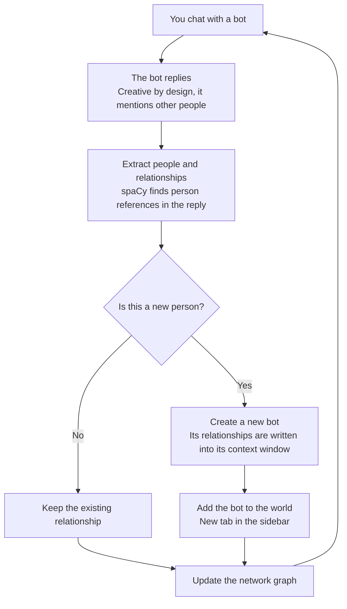
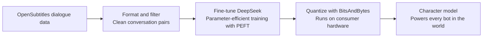

What happens when chatbots can create other chatbots? **GenChatBot** is an environment where every AI character can bring new characters into existence just by talking about them. Mention a sister, a rival, or an old mentor, and that person becomes a new bot you can talk to, one that already knows who they are and how they're connected to everyone else.

Over time, a single conversation grows into a whole world of unique characters with relationships that build on each other, and a live network graph lets you watch it take shape.

**[View the code on GitHub](https://github.com/Kevin-Wilkes/GenChatBot)**

```youtube
https://www.youtube.com/watch?v=_-9auYABb-o
title: GenChatBot demo: a self-replicating chatbot world
```

*A casual walkthrough recorded mid-experiment. The relationships multiplied so quickly that a few laughs made it into the recording, which is honestly the best evidence of how unpredictable this world gets.*

---

## The idea

Most chatbots exist in isolation. Each conversation starts from nothing, and the bot has no sense of anyone else. GenChatBot flips that: every bot lives inside a shared world and knows its place in it.

The key is **context injection**. When a new bot is created, the program writes its relationships directly into its context window, for example *"your brother is Marcus"* or *"your employer is Elena."* The bot doesn't just play a role; it starts its existence already knowing who matters to it, and it carries that into every reply.

Because the bots are tuned to be as creative as possible, they constantly introduce new people while they talk. Each one can become a new bot, which introduces more people of its own. The result is a web of characters and relationships that nobody scripted in advance.

---

## How a world grows

Each conversation can expand the world. Here's what happens when a bot mentions someone new:



Every new bot can start this loop again, which is what makes the world self-replicating. One opening conversation can branch into families, workplaces, friendships, and feuds.

---

## Building the model

The characters run on a **DeepSeek** language model that I fine-tuned on conversational dialogue, so the bots talk like people rather than like assistants:



- **Training data:** movie and TV subtitle dialogue from OpenSubtitles, formatted and filtered into natural back-and-forth conversation.
- **Efficient fine-tuning:** PEFT trains a small set of added weights instead of the whole model, which makes fine-tuning practical without a data-center GPU.
- **Quantization:** BitsAndBytes compresses the model so it can run locally.

---

## The dashboard

The whole environment runs in a web dashboard built with **Dash**, with two views:

### Chat

- A sidebar lists every bot in the world and updates automatically whenever a new one appears.
- Each bot keeps its own separate conversation history.
- Messages display as chat bubbles, with the input bar pinned to the bottom of the screen.

### Visualization

- An interactive network graph, built with `dash-cytoscape`, shows each bot as a node and each relationship as a labeled connection.
- Relationships are read straight from each bot's context, so the graph always reflects what the bots actually know.
- **Click a person** to see their last 10 messages.
- **Click a connection** to see the relationship and its details.

A background process checks for changes every two seconds, so the graph and sidebar stay in sync as the world grows.

---

## What made this interesting to build

> [!NOTE]
> **Relationships run both ways.** If one bot says *"my sister is Ana,"* Ana's bot is created knowing she has a sibling, and the original bot's context is updated too. Every relationship is written into both characters' context windows, so each one understands the connection from their own side. That two-way consistency is what makes the world feel coherent instead of random.

> [!IMPORTANT]
> **Worlds grow fast.** Because every new character can introduce more characters, the number of bots and relationships tends to explode. A single conversation can branch into an entire extended cast within minutes, which leads to some genuinely surprising (and funny) interactions between characters who were never planned.

> [!TIP]
> **Creativity is the engine.** A cautious bot rarely mentions anyone new, and the world stays small. Tuning the bots toward creative, open-ended replies is what drives the world to grow on its own.

> [!WARNING]
> **Context windows are finite.** Every relationship takes up room in a bot's context. As characters build larger social circles, deciding what each one needs to remember becomes a real design problem.

---

## Tech stack

- **Python**
- **DeepSeek** language model, fine-tuned with **Hugging Face Transformers** and **PEFT**
- **BitsAndBytes** quantization and **PyTorch**
- **spaCy** for extracting people and relationships from text
- **Dash** and **dash-cytoscape** for the dashboard and network graph

---

## Where this could go

The same approach of giving AI agents structured memory about each other applies well beyond storytelling: simulated customers for testing products, characters for games and interactive fiction, or training scenarios with realistic, interconnected roles.

Optimus Codeworks builds AI tools like this one. If you have an idea that needs language models working together, [get in touch](/contact/).
