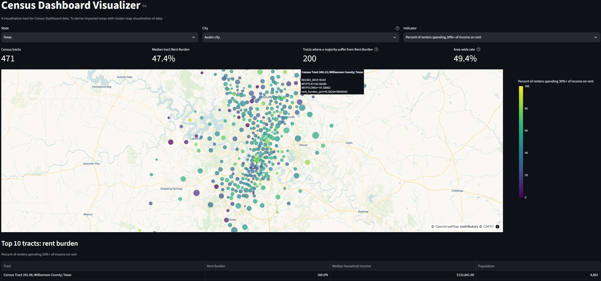
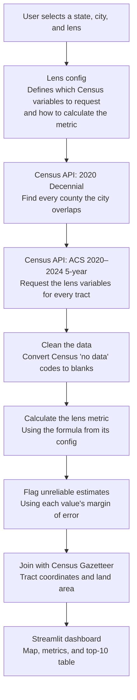

Citywide averages hide the neighborhoods that need help the most. This dashboard breaks any U.S. city down into its census tracts and maps what's happening in each one, using live data from the U.S. Census Bureau.

It started as a single analysis: where are renters most cost-burdened? It grew into something more flexible. Users can now switch between multiple **lenses** to look at the same city from different angles, and adding a new lens takes one configuration entry, not new code.

<!--**[Try the live demo](LIVE-DEMO-URL)** · --> 
**[View the code on GitHub](https://github.com/Kevin-Wilkes/Census_Dashboard)**

<!-- Add a screenshot: put the image in src/images/ and uncomment the next line -->


---

## The problem

Agencies and organizations make decisions about where to send resources: rental assistance, benefits outreach, broadband investment. A city-wide number tells you a problem exists, but not *where* it is.

This tool answers that question at the census tract level, where each area holds roughly 4,000 people. That's small enough to point to specific neighborhoods, and the lens system means the same map can answer many different questions.

---

## The lenses

Each lens is a different way of reading the same city:

| Lens | What it shows | Why it matters |
|---|---|---|
| **Rent burden** | Share of renters spending 30%+ of income on rent | The standard U.S. housing affordability measure, used to target rental assistance |
| **Poverty rate** | Share of residents below the federal poverty line | Guides outreach for benefits programs |
| **No internet access** | Share of households without an internet subscription | A key measure for digital-equity and broadband programs |
| **Median household income** | Typical household income in each tract | Context for every other lens |

Switching lenses updates the map, the headline metrics, and the ranked table together.

---

## How it works

Everything is pulled live from the Census Bureau API. The selected lens decides which variables are requested and how the result is calculated:



### Adding a new lens

Lenses are defined as data rather than code. Each one lists the Census variables it needs and how to combine them, so the API request, the calculation, and the visuals all build themselves from that definition. A lens entry looks like this:

```python
"no_internet_pct": {
    "label": "% of households with no internet access",
    "numerator": ["B28002_013E"],     # households without internet
    "denominator": ["B28002_001E"],   # all households
    "min_denominator": 50,            # skip tracts too small to be meaningful
},
```

Adding a lens means adding an entry like this one. The dashboard picks it up automatically: it appears in the dropdown, its variables are added to the API request, and the map, metrics, and table all adapt. Hundreds of measures are available in the American Community Survey, from commute times to language spoken at home, so the dashboard can grow to answer new questions without touching the interface.

### Clean separation of responsibilities

Each stage lives in its own module, so the user interface never touches API logic and the data transforms never touch the interface:

- **`census/client.py`** handles every request to the Census API, with automatic retries and clear error messages for problems like an invalid API key or a geography with no data.
- **`census/transform.py`** holds the lens definitions, cleans the raw numbers, calculates each metric, flags unreliable estimates, and joins in tract locations.
- **`census/viz.py`** builds the map and automatically zooms it to whichever city is selected.
- **`app.py`** is the Streamlit interface, and nothing else.

That separation is what makes the project testable: the data logic is covered by `pytest` unit tests with the API calls mocked out, and a GitHub Actions workflow runs the checks on every push.

---

## Features

- **Any city, any state.** Pick from dropdowns; no geography codes required.
- **Switchable lenses.** View the same city through housing, poverty, connectivity, and income.
- **Extensible by design.** New lenses come from a single configuration entry.
- **Tract-level map.** Each tract is colored by the selected lens and framed automatically to the chosen city.
- **Top 10 table.** The tracts that rank highest on the current lens.
- **Reliability flags.** Estimates with large margins of error are marked so they aren't over-interpreted.

---

## Real-world data challenges

Government data is messy in ways that don't show up in tutorials. A few of the problems this project had to solve:

> [!NOTE]
> **Cities don't follow county lines.** A city's boundary can cross several counties, so the app first asks the Census API which counties a city overlaps, then pulls tracts from each one. Some of those overlaps contain zero residents (a stretch of road or undeveloped land), and the app filters them out rather than counting them.

> [!NOTE]
> **"No data" is disguised as numbers.** The Census API marks missing values with large negative codes like `-666666666`. Left alone, these would wreck any average. The transform step converts them to proper blanks before any math happens.

> [!WARNING]
> **Small areas mean bigger uncertainty.** Every American Community Survey estimate comes with a margin of error, and at the tract level it can be large. Each lens sets a minimum population size, so tracts too small to produce a meaningful percentage are excluded, and estimates with high uncertainty are flagged.

> [!TIP]
> **The API returns numbers, not locations.** To place tracts on a map, the app joins each tract's ID to the Census Gazetteer file, which provides coordinates and land area. A one-time script trims that national file down to a small Parquet file the app loads instantly.

---

## Tech stack

- **Python** with **pandas** for data processing
- **Streamlit** for the interactive dashboard
- **U.S. Census Bureau API**: ACS 2020–2024 5-year estimates and the 2020 Decennial Census
- **Census Gazetteer** files for tract coordinates and land area
- **pytest** and **GitHub Actions** for automated testing

---

## Run it yourself

The full setup instructions are in the [GitHub README](https://github.com/Kevin-Wilkes/Census_Dashboard). In short:

```bash
python -m venv .venv
.venv\Scripts\activate            # macOS/Linux: source .venv/bin/activate
pip install -r requirements.txt
copy env.example .env             # macOS/Linux: cp env.example .env
streamlit run app.py
```

A free Census API key goes in the `.env` file, though the app also runs without one at low volume.

---

## Need something like this?

Optimus Codeworks builds data tools that turn public or internal datasets into dashboards people can actually use. If you have data that should be answering questions for you, [get in touch](/contact/).
