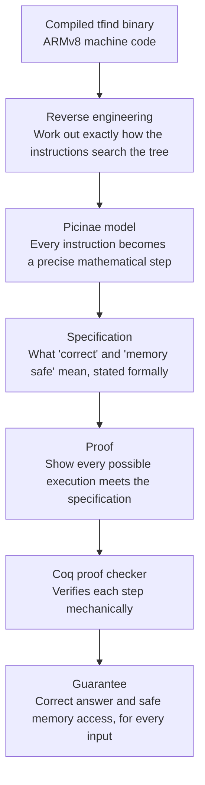

Testing can show that a program worked on the inputs you tried. It can't tell you what happens on the input you didn't think of. **Formal verification** closes that gap: instead of running the program and hoping, you write a mathematical proof that it behaves correctly for *every* possible input.

For a graduate course in language-based security, I led a team that did exactly that for a real compiled program: `tfind`, a binary tree search running as **ARMv8 machine code**. We proved two things about it:

1. **It always returns the correct answer.**
2. **It never reads memory outside the tree it was given.**

Every step of those proofs was checked by a computer, so there's no room for a hand-waved argument to slip through.

**[View the project on GitHub](https://github.com/micahwarner/tfind_Picinae)**

---

## Why verify machine code?

Most verification work happens on source code. The catch is that source code isn't what actually runs: a compiler translates it into machine instructions, and a bug or unexpected optimization in that translation can undo guarantees made at the source level.

**Picinae**, a framework developed by researchers at UT Dallas, takes a stricter approach. It models the processor itself, so proofs are about the exact instructions the computer executes. If a property is proven in Picinae, it holds for the real binary, with no need to trust the compiler.

This style of verification is used where failures are unacceptable: aircraft control, medical devices, cryptography, and operating system kernels.

---

## How the verification works

1. **Reverse engineering.** We started with only the compiled program. Using reverse engineering tools, we worked out exactly how `tfind` searches a binary tree: it walks from node to node by jumping to precise memory addresses stored in each node.
2. **Modeling.** Picinae translates each ARMv8 instruction into a mathematical description of how it changes the processor's registers and memory.
3. **Specifying.** We wrote down, in formal logic, what it means for `tfind` to be correct and memory safe.
4. **Proving.** We proved that every path through the program satisfies that specification, in the **Coq** proof assistant, which refuses to accept any step it can't verify.

---

## The hardest part: memory jumps

> [!IMPORTANT]
> **Every pointer could, in principle, point anywhere.** When `tfind` follows a pointer to the next node, the proof has to account for every address that pointer could hold. On paper that's an infinite space of possibilities, and a proof has to cover all of them.

The solution was to narrow that space with careful reasoning: what a valid tree must look like, which addresses its nodes can occupy, and the hard limits of a real machine, such as the finite size of memory and how addresses wrap around.

That meant reasoning about extremes. A tree could, in theory, be large enough to fill an entire hard drive, and the proof had to show that `tfind` still behaves correctly and never strays outside the tree even then. Ruling out these edge cases is exactly what testing can't do, and it's where formal verification earns its keep.

---

## My role

I led a team on this project and did most of the proof work. The proof split into **eight logical branches**, one for each distinct way execution can flow through the program, and each had to be proven on its own. I completed six of the eight.

Micah Warner built the supporting axioms the proofs rely on, and our other teammates completed the remaining branches. Splitting the work by branch let us progress in parallel while relying on a shared foundation.

> [!NOTE]
> **Scope.** We fully proved correctness and memory safety. Further security properties, such as guarantees about execution time, were beyond what we could complete within the course.

---

## The course

This was for a graduate course in language-based security, one of the most rigorous and rewarding classes I've taken. Before every session we read a research paper and were quizzed on it, so the project sat on top of a steady diet of current security research. Getting to apply those ideas to real machine code was the highlight.

---

## Tech stack

- **Coq** (now Rocq) proof assistant
- **Picinae** framework for modeling and verifying machine code
- **ARMv8** instruction set
- **Reverse engineering tools** for analyzing the compiled binary

---

## Why this matters for your project

Most software never needs a formal proof. But the habits behind it, such as defining exactly what "correct" means, reasoning about edge cases before they happen, and not trusting a result until it's checked, make for more reliable software at any scale.

Optimus Codeworks builds software with that same care. If you need code you can depend on, [get in touch](/contact/).
